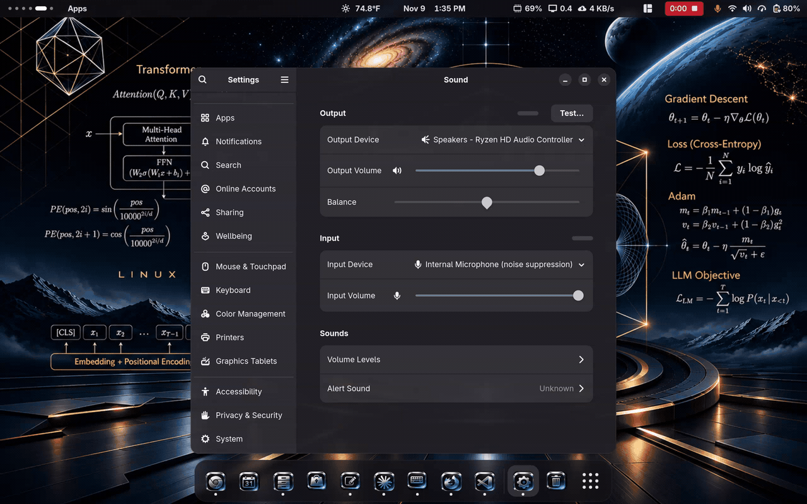
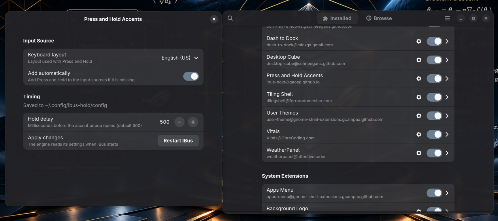

# ibus-hold: macOS-style Press-and-Hold for Linux

<https://crates.io/crates/ibus-hold>


> 🍎 Get macOS-style accent selection on Linux. Hold a key to reveal accented variants, pick with number keys or arrow keys.

**ibus-hold** is a Linux input method that brings familiar macOS-style character selection to the desktop. It requires IBus and has been tested on Fedora 44 Workstation with GNOME; other distributions and IBus desktops may work but are not yet tested.



## 🚀 Quick Start (30 seconds)

### Fedora Workstation (GNOME)
```sh
# 1. Install
sudo dnf install https://github.com/geosp/ibus-hold/releases/download/v0.1.3/ibus-hold-0.1.3-1.fc44.$(uname -m).rpm

# 2. Reload IBus
ibus restart

# 3. Enable in Settings → Keyboard → Input Sources → Add → Search "Press and Hold"
# 4. Switch with Super+Space
```

### Other Linux Distributions
```sh
# Debian 12+ / Ubuntu 22.04+
sudo apt install ./ibus-hold_*.deb  # Download from Releases page
ibus restart
```

**Full installation guide for all distributions:** [doc/ibus-install.md](doc/ibus-install.md)

### Optional: GNOME Shell extension

A companion extension adds a **Press and Hold** toggle to Quick Settings, adds
the input source for you, and gives you a preferences window for the layout and
hold delay. It needs the package above. See [gnome-extension/](gnome-extension/README.md).



## ✨ Features

- **Press-and-Hold Accent Picker**: Hold any letter to reveal accented variants (è, é, ê, ë, etc.)
- **Fast & Responsive**: Lightweight Rust implementation with configurable delay
- **17 Keyboard Layouts**: US, UK, German, French, Spanish, Portuguese, Italian, Scandinavian, Polish, Turkish, and more
- **Customizable**: Configure variants and delay via `~/.config/ibus-hold/config`
- **Pure Rust**: No GObject or C bindings; IBus is required
- **Desktop support**: Tested with GNOME on Fedora 44 Workstation; other IBus desktops are untested

## 📦 How It Works

Hold a letter for ~0.5 seconds to see available accented variants:

```
Hold 'e' → [ è  é  ê  ë  ē  ė  ę ]
           Press 1-9 to pick, or use arrows + Enter
```

- **Tap** = normal letter
- **Hold** = accent menu
- **Shift+Hold** = uppercase variants

## 🏗️ Architecture

This repository is a Cargo workspace with two crates:

- **`ibus-engine/`** ([docs](https://docs.rs/ibus-engine)): A pure-Rust library for writing IBus input method engines. Talks directly to ibus-daemon over D-Bus via [zbus](https://github.com/dbus2/zbus/), without GObject or C bindings. Perfect for systems programming projects.
- **`ibus-hold/`**: A complete example of an input method engine built on ibus-engine, implementing the press-and-hold UI.

`gnome-extension/` holds the optional GNOME Shell companion extension (JavaScript).

## 🛠️ For Library Users (ibus-engine)

Want to build your own IBus input method in Rust? The `ibus-engine` library is production-ready:

```toml
[dependencies]
ibus-engine = "0.3"
```

**Features:**
- `tokio` (default): use the tokio runtime for D-Bus
- `async-io`: use the async-io runtime instead

**Example:** See `ibus-hold/src/engine.rs` for a complete, real-world implementation.

**API Documentation:** <https://docs.rs/ibus-engine>

### Quick Library Example

```rust
use ibus_engine::{IBusEngine, IBusFactory, IBusEngineBackend};

struct MyEngine { }

impl IBusEngine for MyEngine {
    fn process_key_event(&mut self, _keyval: u32, _keycode: u32, _state: u32) -> bool {
        // Your input method logic here
        false
    }
    // ... implement other trait methods
}

impl IBusFactory for MyEngine {
    fn create(&self, _engine_name: &str) -> Box<dyn IBusEngine> {
        Box::new(MyEngine { })
    }
}
```

## 💻 Development

```sh
# Test
cargo test --workspace

# Format & lint
cargo fmt --all --check
cargo clippy --workspace --all-targets

# Generate docs
cargo doc --open
```

**Minimum Requirements:**
- IBus 1.5.34+ (required to run; commonly included with GNOME)
- Linux (tested on Fedora 44 Workstation with GNOME; other distributions and desktops are untested)
- rustc 1.99.1+ only if building from source

## 🤝 Contributing

We welcome contributions! Whether you're fixing bugs, adding layouts, improving documentation, or building new features:

1. **Fork & Clone** the repository
2. **Create a feature branch** (`git checkout -b feature/your-idea`)
3. **Make your changes** and test thoroughly:
   ```sh
   cargo test --workspace
   cargo clippy --workspace
   cargo fmt --all
   ```
4. **Push & Create a Pull Request** with a clear description

### Ways to Help

- **📍 Add a keyboard layout** - Edit `ibus-hold/src/layouts.rs` and open a PR
- **🐛 Report bugs** - Use GitHub Issues with reproduction steps
- **📖 Improve docs** - Help make the installation guide clearer
- **🌍 Translate** - Help internationalize the UI
- **💡 Suggest features** - Open an issue to discuss ideas

### Running Tests & Checks

```sh
# Run all tests
cargo test --workspace

# Format code
cargo fmt --all

# Lint with clippy
cargo clippy --workspace --all-targets

# Check docs
cargo doc --no-deps --open
```

**License:** Choose `LGPL-2.1-or-later` or `GPL-3.0-or-later` for your contributions.

## 🔗 Resources & Links

### Input Method Frameworks
- [IBus](https://github.com/ibus/ibus) — Intelligent Input Bus for Linux/Unix
- [D-Bus](https://www.freedesktop.org/wiki/Software/dbus/) — Message bus for Linux applications
- [zbus](https://github.com/dbus2/zbus/) — Rust D-Bus API

### Desktop Environments
- [GNOME Shell](https://wiki.gnome.org/Projects/GnomeShell) — Default on Fedora, Ubuntu
- [KDE Plasma](https://kde.org/plasma) — Popular alternative
- [XFCE](https://www.xfce.org/) — Lightweight option

### Languages & Tools
- [Rust Programming Language](https://www.rust-lang.org/) — Systems programming, memory safety
- [GObject](https://docs.gtk.org/gobject/) — Traditional GLib object system

## 📄 License

This repository is released under your choice of:
- **LGPL-2.1-or-later** — Link freely with proprietary code
- **GPL-3.0-or-later** — Share improvements with the community

The `ibus-engine` library is based on code from [fm-elpac/librush](https://github.com/fm-elpac/librush) by secext2022.

---

**Have questions?** Check [doc/ibus-install.md](doc/ibus-install.md) for full installation, configuration, and troubleshooting guides. Found a bug? [Open an issue](https://github.com/geosp/ibus-hold/issues).
